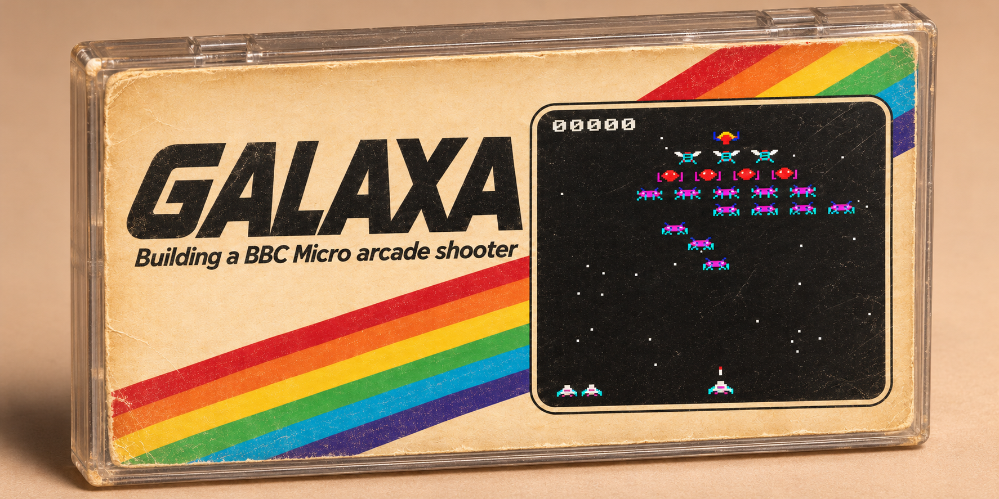

# Galaxa (BBC Micro)

An original fixed shooter for the BBC Micro Model B, written in 6502 assembly in 2026.
MODE 2, eight colours, 50 frames a second.

## Play in the browser

**https://newell-paul.github.io/galaxa-6502/**

Press any key to start. On a phone or tablet, tap **FIRE** to start and hold the
on-screen arrows to move; turn it sideways for the biggest screen.

**Full screen:** the page's Full screen button (<kbd>Esc</kbd> to leave). On an iPhone,
use Share → Add to Home Screen instead: it opens from there with no browser bars.

| Key | Action |
|-----|--------|
| <kbd>Z</kbd> | Left |
| <kbd>X</kbd> | Right |
| <kbd>Return</kbd> | Fire |

## How it plays

- Aliens wait in formation and peel off to dive at you. The boss dives with two guards.
- Shoot the boss and it drops a **P** capsule. Catch it to power up: double shot, then
  rapid fire. Your ship's wings show the level (cyan, yellow, red). Losing a ship
  costs one level.
- Hits on a falling capsule score too, and pay more as the game goes on, so with rapid fire
  it pays to shoot the boss high up and keep the capsule in the air.
- Each stage dives sooner and fires more, up to stage 8; after that the dives keep
  coming a frame sooner each stage.
- The formation changes shape from stage to stage, four shapes by turns.
- Every four stages the aliens change colour.
- Three ships. Each new stage adds a bonus.
- A score in the top five asks for three initials on the title screen: A to Z, DELETE to step back.
- Passing the top score plays a fanfare. The browser version keeps the score table between visits.
- The boss is worth the most and the rows score less going down. Diving aliens score more,
  and shooting a whole swoop earns a bonus and a jingle.

## Build and run

Needs [BeebASM](https://github.com/stardot/beebasm) and Node.js.

```bash
make              # build galaxa.ssd
make run          # build, then open it in a local jsbeeb
make run-debug    # debug build: P cycles the power level
make serve        # the browser page, at http://localhost:8086/
make web          # rebuild web/, the page's emulator, from a jsbeeb checkout
```

Or load `galaxa.ssd` in any BBC Micro emulator and press Shift+Break.

## Tests

`make test` runs the game headless in [jsbeeb](https://github.com/mattgodbolt/jsbeeb)
and checks it frame by frame: sprites where RAM says, no tearing, no dropped frames, and
the capsule rules. It expects a jsbeeb checkout at `~/.local/share/jsbeeb` (set
`JSBEEB_DIR` to use another).

## Files

| File | What it is |
|------|------------|
| `galaxa.asm` | The game |
| `galaxa.ssd` | The built disc, which the browser page boots |
| `index.html` | The browser page (GitHub Pages) |
| `manifest.webmanifest` | Lets phones add the page to the home screen |
| `web/` | The page's emulator: jsbeeb bundled, GPL-3.0 (see `web/README.txt`) |
| `tools/web/` | Builds `web/`: the emulator page script and its bundler |
| `tools/title.mjs` | Builds the MODE 7 title screen |
| `tools/smoothness.mjs` | Frame-by-frame smoothness test |
| `tools/capsule.mjs` | Capsule and power-up test |
| `!BOOT` | Disc boot file |
| `Makefile` | Build, run and test |

## Licence

© 2026 Paul Newell. Released under the MIT licence; see [`LICENSE`](./LICENSE).

The files in `web/` bundle jsbeeb and are GPL-3.0-or-later; see `web/LICENSE-jsbeeb.txt`.
The BBC ROMs are not in this repository: the page loads them from bbc.xania.org.
